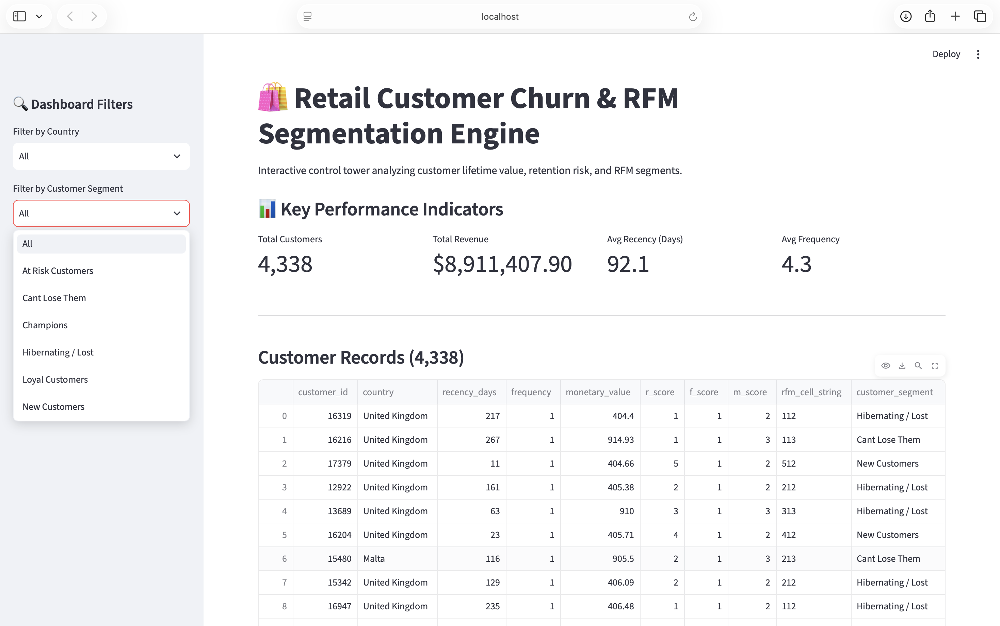

# Retail Churn & RFM Segmentation Engine

[](https://retail-app-mjrjraqretz97u22vmx3yp.streamlit.app)
[](https://www.python.org/)
[](https://www.postgresql.org/)
[](https://pandas.pydata.org/)

An end-to-end customer analytics pipeline and interactive Streamlit control tower designed to quantify customer lifetime value (LTV), segment buyer behavior using RFM (Recency, Frequency, Monetary) modeling, identify churn risk, and eliminate revenue leakage across global retail operations.

---

## 🏢 Business Problem
Retail and e-commerce enterprises frequently suffer from unmonitored customer churn and misallocated marketing spend driven by:
- **Blind Churn Exposure:** Inability to proactively identify high-value buyers slipping into dormancy before they churn permanently.
- **One-Size-Fits-All Marketing:** Treating low-value sporadic buyers the same as core "Champions," resulting in eroded margins and inefficient promotional budgets.
- **Multi-Region Blind Spots:** Managing diverse geographic markets (e.g., United Kingdom, Germany, France) without normalized behavioral scoring across purchasing cadences.

---

## 🛠️ Tech Stack & Architecture
- **Database & Modeling:** PostgreSQL (Star-Schema Pipeline & SQL Views)
- **Data Engineering & Scripting:** Python, Pandas, SQLAlchemy
- **Interactive Web App:** Streamlit (Custom Python Web Dashboard)
- **Deployment & Hosting:** Streamlit Community Cloud (Flat-file standalone architecture)
- **Version Control:** Git & GitHub

---

## 🏗️ How It Was Built (Project Flow)

1. **Star-Schema Modeling (PostgreSQL):** Designed a robust relational database structure (`dim_customers`, `dim_products`, and `fact_retail_transactions`) to ingest raw UCI Online Retail logs, stripping null customer IDs and canceled invoices.
2. **RFM Metrics & Scoring (Python & SQL):** Programmatically computed Recency (days since last purchase), Frequency (total unique invoices), and Monetary value (total spend) per customer, backed by SQL window functions and percentile ranking views.
3. **Standalone Production Architecture:** Decoupled the analytics engine from local database dependencies by exporting clean aggregated views to structured CSV flat files (`retail_customer_segments.csv`), enabling seamless cloud hosting.
4. **Interactive Web Application (Streamlit):** Developed and deployed a Python-driven web app (`app.py`) featuring dynamic side-by-side country and segment filters, responsive KPI metric cards, and a filterable customer record explorer.

---

## 📊 Key Features & Visualizations
- **Executive KPI Cards:** Real-time visibility into Total Active Customers, Total Revenue, Average Recency (Days), and Average Purchase Frequency.
- **Granular Segment Filtering:** Instant isolation of high-value or churn-risk tiers (Champions, At Risk, Loyal, Hibernating).
- **Multi-Region Slicers:** Country-level breakdown allowing stakeholders to audit regional revenue concentration.
- **Searchable Customer Data Grid:** Full tabular view of customer IDs, RFM scores, and assigned behavioral clusters.

---

## 🎨 Application Screenshots

### 💻 Streamlit Interactive Web Application - Overview & Metrics


---

## 📂 Project Directory Structure

```text
retail-customer-churn-engine/
├── scripts/
│   ├── db_loader.py                     # PostgreSQL connection and view loader
│   └── etl_pipeline.py                  # Raw CSV data cleaning and star-schema ingestion
├── sql/
│   ├── 01_schema.sql                    # PostgreSQL star-schema tables & constraints
│   ├── 02_rfm_raw_view.sql              # SQL window functions for RFM calculations
│   └── 03_customer_segmentation.sql     # SQL views for behavioral scoring & segmentation
├── data/
│   ├── online_retail.csv                # Raw transactional dataset source
│   └── customer_segments.csv            # Cleaned and RFM-scored flat dataset for cloud deployment
├── app.py                               # Streamlit interactive web application
├── streamlit_app.png                    # Streamlit dashboard overview screenshot
└── README.md                            # Project documentation & portfolio guide
```
---

## 💡 Key Business Insights & Strategic Recommendations

Based on the RFM segmentation analysis conducted across **4,338 unique active customers** generating **$8,911,407.90** in total revenue, buyer behavior exhibits extreme Pareto concentration. The key revenue distributions and retention strategies are outlined below:

### 1. Primary Revenue Drivers & Churn Vulnerabilities
- **The Champion Core:** **963 Champions (22.2% of customers)** drive **$5,771,673.46 (64.8%)** of total network revenue, characterized by high frequency (avg. 11.0 purchases) and exceptional recency (avg. 12.1 days).
- **High-Value Churn Risk ("At Risk" & "Can't Lose Them"):** **820 customers** combined fall into high-value danger zones, accumulating over **$1.13 million** in historical revenue while currently sitting at high recency gaps (avg. 147 to 186 days since last purchase).
- **Dormant Bloat ("Hibernating / Lost"):** **1,403 customers (32.3% of the base)** are classified as hibernating, contributing only **4.5% ($396,697.01)** of total revenue, representing wasted database storage and email marketing fatigue if unsegmented.
- **Geographic Concentration:** The **United Kingdom** accounts for the vast majority of active customer profiles (**3,920 accounts**), followed by European expansion markets like **Germany (94)** and **France (87)**.

### 2. Actionable Growth & Retention Strategy
- **VIP Retention Triggers:** Protect the Champion segment by establishing VIP loyalty perks and early access programs to maintain their 12-day purchase cadence.
- **Automated Win-Back Campaigns:** Target the 649 *At Risk* customers with automated re-engagement email sequences and time-sensitive discounts before they transition into the *Hibernating* bucket.
- **Re-allocation of Marketing Budget:** Deprioritize broad-brush acquisition campaigns; instead, reallocate spend toward rescuing high-monetary *Can't Lose Them* accounts (avg. spend over $1,415 per customer) who have lapsed past 180 days.
